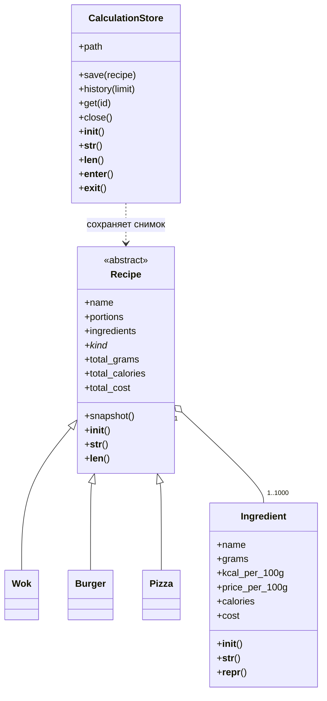
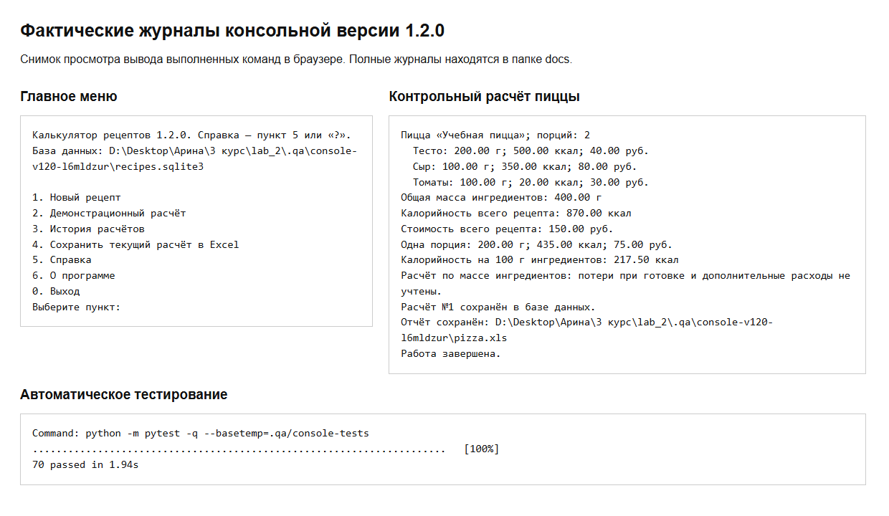

# Отчёт по лабораторной работе 2

**Вуз:** [вписать]

**Факультет и кафедра:** [вписать]

**Дисциплина:** [вписать]

**Тема:** Модули и пакеты Python. ООП

**Приложение:** Калькулятор рецептов

**Вариант:** 9 по порядку, строка с меткой 11 в методичке

**Уровень:** Well-done; программная часть и контейнерный запуск проверены

**Выполнил(а):** [ФИО], группа [вписать]

**Проверил(а):** [ФИО преподавателя]

**Город и год:** [город], 2026

## Цель работы

Разработать MVP на Python с модульной структурой и объектно-ориентированной моделью.
Применить абстрактные классы, наследование, управляемые атрибуты, специальные методы,
автоматическое тестирование, сохранение результатов и упаковку приложения в Docker.

## Условие и определение варианта

Девятое задание по порядку — «Рецепты». В таблице после номера 7 сразу следует 10,
поэтому девятая строка имеет напечатанный номер 11. Требуется реализовать объекты
«Вок», «Бургер» и «Пицца» и рассчитывать энергетическую ценность и стоимость рецепта
в зависимости от ингредиентов.

Приложение имеет единый консольный интерфейс для Windows и Docker и экспорт в `.xls`,
README и файлы зависимостей. Для уровня Medium реализованы ABC и абстрактное свойство,
иерархия наследования, свойства с setter, специальные методы и тесты pytest.
Для Well-done добавлены SQLite и Dockerfile с установкой библиотек при сборке.

## Репозиторий

Ссылка на репозиторий с программной реализацией: [https://github.com/stitch2277-bit/lab_2_a](https://github.com/stitch2277-bit/lab_2_a).

## Математическая модель

Для каждого ингредиента пользователь задаёт массу `m_i` в граммах, калорийность
`k_i` в ккал на 100 г и цену `p_i` в рублях на 100 г.

```text
E_i = m_i × k_i / 100               калории ингредиента
C_i = m_i × p_i / 100               стоимость ингредиента
M = Σ m_i                          масса ингредиентов
E = Σ E_i                          калории рецепта
C = Σ C_i                          стоимость рецепта
M_порции = M / n                    масса одинаковой порции
E_порции = E / n                    калории порции
C_порции = C / n                    стоимость порции
E_100г = E × 100 / M                калории на 100 г ингредиентов
```

Масса каждого ингредиента больше нуля, поэтому деление на общую массу определено.
Число порций `n` — положительное целое. Стоимость и калорийность неотрицательны.
Внутренние расчёты выполняются с `Decimal`; округление до двух знаков применяется
при выводе. Масса готового блюда принимается равной сумме масс ингредиентов.
Потери при готовке, закупка целых упаковок, накладные расходы и наценка не учитываются.

Формулы получены пересчётом величин с базы 100 г на фактическую массу
и сложением вкладов ингредиентов; дополнительные пищевые справочники не использовались.

## Структура программы

Основная программа `main.py` без аргументов открывает консольное меню.
Локальный батник и Docker запускают этот же файл. Он подключает пакет `recipes`, содержащий три рабочих модуля:
`models.py` с предметной моделью, `storage.py` для SQLite и `reports.py` для вывода и Excel.
`__init__.py` обозначает пакет и не содержит рабочей логики.
Интерфейс отделён от формул, благодаря чему модель проверяется без ручного ввода.

## UML классов



`Ingredient` хранит данные одной позиции и рассчитывает её стоимость и калории.
Проверки в свойствах выполняются при создании и последующем изменении объекта.
`Recipe` содержит общие формулы, число порций и набор ингредиентов; абстрактное свойство
`kind` определяет вид блюда. `Wok`, `Burger` и `Pizza` задают тип; общие формулы наследуются.
`snapshot()` создаёт независимую структуру данных для вывода, хранения и экспорта.

`CalculationStore` открывает SQLite, создаёт таблицу `calculations`, записывает дату UTC
и JSON-снимок расчёта, читает историю и закрывает соединение при выходе из `with`.
SQL-запросы параметризованы. Методы `save`, `history`, `get` предоставляют доступ к данным.
В каждом классе явно определены как минимум `__init__` и `__str__`.

## Интерфейс и обычные возможности приложения

Программа использует единое консольное меню в Windows и Docker:

```text
1. Новый рецепт
2. Демонстрационный расчёт
3. История расчётов
4. Сохранить текущий расчёт в Excel
5. Справка
6. О программе
0. Выход
```

Пользователь последовательно вводит тип блюда, название, число порций и ингредиенты.
После расчёта итоги выводятся в консоль и автоматически сохраняются в SQLite.
История показывает последние 20 записей и позволяет открыть расчёт по номеру,
просмотреть его и повторно экспортировать в Excel.

Отдельно предусмотрены встроенная справка и раздел «О программе» с версией.
На любом запросе «?» или «справка» показывает помощь и повторяет запрос,
«назад» или «отмена» возвращает в меню, «выход» или «exit» завершает программу.
Ctrl+C и конец ввода обрабатываются с закрытием соединения SQLite.
Неверные значения объясняются пользователю; после ошибки ввода запрос повторяется.
Для каждой величины указаны единицы измерения. Перед заменой существующего
Excel-файла требуется подтверждение. Если запись в БД не удалась,
расчёт остаётся доступным для экспорта в текущем сеансе.
Батник сохраняет интерактивный ввод и вывод; при ошибке показывает причину и ждёт клавишу.

## Тестирование

Тесты находятся в `tests` и запускаются командой `python -m pytest -q`.
Проверены три типа блюд, суммы и значения на порцию, калории на 100 г,
округление без преждевременного округления слагаемых, свойства, абстрактный класс,
неверные данные, чтение истории после повторного открытия БД, содержимое реального
Excel-файла, кириллица, справка, отмена, выход и обработка ошибок.

Контрольный пример: тесто 200 г (250 ккал и 20 руб. на 100 г), сыр 100 г
(350 ккал и 80 руб. на 100 г), томаты 100 г (20 ккал и 30 руб. на 100 г).
Ожидаемые итоги: 400 г, 870 ккал, 150 руб.; на одну из двух порций — 200 г,
435 ккал, 75 руб.; на 100 г — 217,5 ккал.

**Результат автоматической проверки:** 70 тестов пройдены; фактический вывод сохранён в `docs/test-results.txt`.

Дополнительно проверен реальный run.bat: запуск из другой рабочей папки с пробелами
и кириллицей в пути, передача аргументов, интерактивный ввод и сохранение кода ошибки.
Проверка основного файла без аргументов подтверждает открытие консольного меню,
справки и раздела «О программе». Ручной сценарий через батник проверил ввод
рецепта, ошибочный тип блюда, историю и экспорт.



**Рисунок 2 — снимок страницы с фактическими журналами меню, контрольного расчёта и pytest.**
Страница отображает сохранённый вывод выполненных команд; это просмотр журналов в браузере.

Фактический вывод автоматических тестов:

```text
70 passed
```

Полный журнал запуска сохранён в `docs/test-results.txt`.

## Контейнерная часть Docker

Реальная проверка выполнена 17 ноября 2026 года. На компьютере работает Docker Desktop
4.99.0 с Docker Engine 29.9.3 (Linux/amd64) и Compose 5.7.0.
Конфигурация compose.yaml проверена командой docker compose config --quiet.

Dockerfile использует Python 3.12 и устанавливает зависимости до запуска программы.
В образе recipes-lab:local запускается консольный интерфейс с тем же пакетом recipes.
Compose подключает папку data к /app/data. Отдельный сервер БД не нужен: sqlite3
сохраняет файл базы в общей папке. Локальный и контейнерный запуск используют один main.py и requirements.txt.

Скрипт verify_docker.py успешно собрал образ и запустил первый контейнер.
В нём рассчитана пицца: 870 ккал, 150 руб.; созданы SQLite и настоящий Excel .xls.
После удаления первого контейнера второй контейнер прочитал ту же базу и отчёт
и проверил результаты. Это подтверждает сохранение данных между разными контейнерами.
Также проверен запуск меню без аргументов через Compose: справка, раздел «О программе» и выход.
Проверка образа подтвердила отсутствие графических библиотек.

```text
Image: recipes-lab:local
Pizza: 870 kcal, 150 RUB
PASS: second container read the first container database and XLS report
PASS: image built; calculation and persistence between two containers verified.
```

Полный журнал реального запуска: docs/docker-verification.txt.
Тестовые контейнеры удалены флагом --rm, образ и файлы проверки сохранены.
В Docker Desktop образ доступен во вкладке Images; запуск приложения — через run_docker.bat.
Локально дополнительно пройдены 70 тестов pytest. Требования Well-done по SQLite
и контейнерному запуску подтверждены. Инструкция находится в DOCKER.md.

## Вывод

Разработано приложение расчёта калорийности и стоимости трёх видов рецептов.
Модель построена на классах и наследовании, проверка значений выполняется свойствами.
Программа имеет консольный интерфейс, сохраняет историю в SQLite,
экспортирует Excel-отчёт и содержит встроенную справку.
Предметные расчёты и основные пользовательские сценарии покрыты тестами pytest.

## Использованные материалы

1. Методические указания `algorythms_python_lab_02.docx`.
2. [Python ABC](https://docs.python.org/3/library/abc.html).
3. [Python Decimal](https://docs.python.org/3/library/decimal.html).
4. [Python SQLite](https://docs.python.org/3/library/sqlite3.html).
5. [xlwt API](https://xlwt.readthedocs.io/en/latest/api.html).
6. [pytest](https://docs.pytest.org/en/stable/).
7. [Dockerfile](https://docs.docker.com/reference/dockerfile/).

## Листинг кода

Полный исходный код: `main.py`, `verify_docker.py`, Dockerfile, compose.yaml, `recipes/models.py`, `recipes/storage.py`,
`recipes/reports.py` и `recipes/__init__.py`.
Полный листинг включён в PDF и в TeX-версию отчёта. Markdown служит редактируемой основой.
